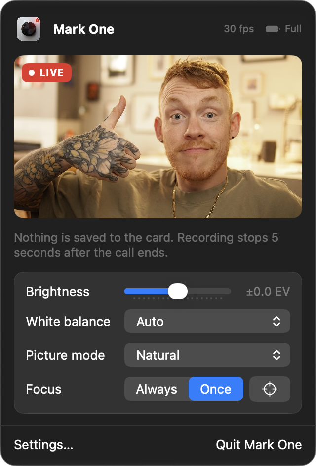

<p align="center">
  
</p>

<h1 align="center">Mark One</h1>

<p align="center">
  <a href="https://superhighfives.com/mark-one/download"><strong>Download for macOS</strong></a>
  ·
  <a href="https://superhighfives.com/mark-one">Website</a>
  ·
  <a href="https://superhighfives.com/mark-one/help">Help</a>
</p>

<p align="center">
  <br>
  <a href="screenshots"></a>
  <br>
  <br>
</p>

Turns an original Olympus OM-D E-M5 (Mark I, 2012) into a Mac webcam over a single USB cable, with the camera's own lens, sensor and color. Out of the box the camera can't do this: it refuses to shoot while HDMI is plugged in, and its USB connection only transfers files. So this project changes its firmware, and a Mac app called Mark One turns the camera into a camera any video app can pick.

## Where it stands

Mark One works end to end, with nothing to click. It sits in the menu bar and can open at login. Plug in the camera, switch it on, choose Webcam on its screen, and open a video app. Mark One:

1. connects through ImageCaptureCore, which shares the camera with macOS's camera service
2. switches the camera to live view with USB connected; with Mark One's firmware, movies need no card, never write to one and have no time limit
3. presses the camera's REC button for you when an app starts using the Mark One camera
4. copies each frame of the camera's 1080p, 30 frames per second H.264 movie stream straight out of its memory, using a list of finished frames the firmware keeps
5. decodes it with Apple's hardware decoder (libavcodec on older firmware revisions, or if that fails)
6. publishes it as the "Mark One" camera through a Core Media IO camera extension, for FaceTime, Zoom, OBS, QuickTime and so on

Recording stops 5 seconds after the last app stops using the camera, and when you quit Mark One. Mark One notices when the camera is switched back on or plugged in again and sets it up again. The camera's power switch turns it off as usual, and Mark One says so. Video reaches the Mac about 200 ms after it happens.

All of this rests on Mark One's firmware: `usb-tools`, which adds USB commands that read and write camera memory and run code, and `webcam`, which adds the Webcam connection, card-free recording and the frame list. Both only add: Storage, MTP, photos, movies, menus and settings work as they did on Olympus's firmware. Mark One installs it for you: it downloads Olympus's firmware 2.3, patches it on your Mac, and writes it to the card for the first install, then updates it over USB. Flashing modified firmware can brick a camera, so read the risks in `NOTES.md` first.

## What's left

`TODO.md` lists everything left before launch, fast follows and longer-term ideas.

## Build it yourself

Mark One is free. A signed, notarized build that keeps itself up to date is at [superhighfives.com/mark-one](https://superhighfives.com/mark-one), or you can build it yourself from the source here. If it's useful to you, you can [support my work](https://github.com/sponsors/superhighfives).

You need a Mac with Xcode and [XcodeGen](https://github.com/yonaskolb/XcodeGen), and an Apple developer team that can sign a camera extension, which uses the System Extension capability. A paid Apple Developer Program membership has it. Then follow the steps under "Mark One" below. Builds from source don't check for updates: to update, pull and build again. Only release builds (`scripts/build-release.sh`, run by `/release`) set the update feed, and updates are signed with Mark One's own key.

Mark One downloads Olympus's firmware from Olympus's own update server and patches it on your Mac, so nothing from Olympus is in this repo or in the app. Since December 2025 the server only hands out firmware the way OM Workspace asks for it; the [mu-43.com firmware thread](https://www.mu-43.com/threads/firmware-updates-for-om-and-em-cameras-january-2023.118773/page-6#post-1837553) shows how, and Mark One asks the same way.

## Mark One

`mac/MarkOne` holds the app, its camera extension and `markone-feed`, an older tool that pipes frames from `scripts/stream.py`. Build it with [XcodeGen](https://github.com/yonaskolb/XcodeGen):

```sh
scripts/build-libavcodec.sh          # once: FFmpeg's H.264 decoder, about a minute
cd mac/MarkOne
cp Local.xcconfig.example Local.xcconfig   # then set DEVELOPMENT_TEAM
xcodegen generate
xcodebuild -project MarkOne.xcodeproj -scheme MarkOne -configuration Debug \
  -derivedDataPath build -allowProvisioningUpdates build
cp -R "build/Build/Products/Debug/Mark One.app" /Applications/
```

The app has to run from `/Applications` to install its camera extension. It installs its camera extension when it opens; approve it the first time in System Settings > General > Login Items & Extensions: click ⓘ beside Mark One and turn on Media Extension (Camera Extensions on older versions of macOS). Quit Mark One normally rather than force-quitting it. Force-quitting it mid-session can leave macOS's camera service stuck, and then the camera doesn't show up again until you unplug it.

## Running it

You need [uv](https://docs.astral.sh/uv/) and `curl`. uv installs Python and the dependencies (`numpy`, and `pyusb` with a bundled libusb) for you.

Install the dependencies, then fetch and unpack the stock v2.3 firmware. The firmware is Olympus's, so it isn't in this repo; the script downloads it and checks its hash.

```sh
scripts/setup.sh
```

Build the patched firmware with any combination of patches. The script checks every byte it replaces, so it won't patch anything other than stock v2.3.

```sh
uv run scripts/build.py fw/OLY_E_097_2300_0000_0000.BIN patched/hdmi-liveview/E0972300.BIN hdmi-liveview
uv run scripts/build.py fw/OLY_E_097_2300_0000_0000.BIN patched/usb-tools/E0972300.BIN usb-tools
uv run scripts/build.py fw/OLY_E_097_2300_0000_0000.BIN patched/usb-tools+webcam/E0972300.BIN usb-tools webcam
```

Check that repacking the unmodified firmware reproduces the original file:

```sh
uv run scripts/build.py --roundtrip fw/OLY_E_097_2300_0000_0000.BIN
```

To flash by hand, copy the `.BIN` into a `DCOLYMP` folder on the SD card, unplug USB and switch the camera off. Hold OK and switch it on, and let go when the orange light on the front comes on. After about a minute the light blinks quickly: switch the camera off, then on again. Don't switch it off, open the battery door or take the card out while the light is on. Mark One does all of this for you (and shows the same steps); Mark One's firmware is `usb-tools webcam`. Restore by flashing the stock file the same way, or from Mark One over USB. `NOTES.md` has the full test plan.

## Talking to the camera over USB

The Python scripts came first and are still the quickest way to experiment. `scripts/ptp.py` sends raw PTP commands. Set the camera's USB Mode to MTP and connect it. macOS's camera service, `ptpcamerad`, claims every camera as it connects; the script stops it and takes the camera.

```sh
uv run scripts/ptp.py info                  # model, firmware and supported commands
uv run scripts/ptp.py peek 0x602adef8 4     # read camera memory (needs usb-tools)
uv run scripts/ptp.py poke 0x7e400000 code.bin   # write camera memory
uv run scripts/ptp.py run 0x7e400000 1 2    # call a function, print d0 and a0
uv run scripts/ptp.py shoot                 # live view with USB connected; movies no longer write the card
uv run scripts/ptp.py output evf            # 800x600 viewfinder image instead of 568x480
uv run scripts/live.py                      # live view in the browser at http://localhost:8000
uv run scripts/live.py --movie              # 1080p while the camera records a movie
uv run scripts/stream.py --raw | mac/viewer/viewer   # 1080p at 30 fps while recording, lowest delay
```

Build the viewer once with `swiftc -O -o mac/viewer/viewer mac/viewer/main.swift` (needs Xcode or the command line tools).

## Reading the code

The camera runs Panasonic MN103 processors. To disassemble it, build GNU binutils for that target into `toolchain/`:

```sh
mkdir -p toolchain && cd toolchain
curl -sSfLO https://ftp.gnu.org/gnu/binutils/binutils-2.43.1.tar.xz
tar xf binutils-2.43.1.tar.xz && mkdir build && cd build
../binutils-2.43.1/configure --target=mn10300-elf --prefix="$PWD/../install" \
  --disable-nls --disable-werror --disable-gdb --disable-gprofng --disable-sim \
  --with-system-zlib MAKEINFO=true
make -j8 MAKEINFO=true && make install MAKEINFO=true
```

Then disassemble the main code block and label it:

```sh
mkdir -p disasm
toolchain/install/bin/mn10300-elf-objdump -D -b binary -m am33-2 \
  --adjust-vma=0x7E421020 unpacked/main.bin > disasm/main.raw.s
uv run scripts/annotate.py unpacked/main.bin disasm/main.raw.s disasm/main.s
```

`disasm/main.s` marks every string a piece of code refers to and labels each function that something calls. The other scripts help you find your way around, and all run with `uv run scripts/<name>.py`:

- `xref.py` finds a string and everything that points at it.
- `findimm.py` finds where a 32-bit value appears.
- `words.py` dumps memory as words and shows any strings they point to.
- `fnname.py` labels a table of function pointers by the first message each function logs.
- `findbase.py` works out where the main block sits in memory (`0x7E421020`).

## How it works

The firmware is a set of scrambled blocks with checksums. `olyfw.py`, from [xulfr/om-emu](https://github.com/xulfr/om-emu), descrambles them. `build.py` changes bytes in the decoded main block, scrambles it again, and fixes the checksum.

The camera's shooting mode already sends live view to the analog video port: when that cable goes in, shooting mode switches the screen output. HDMI gets different treatment. Shooting mode's event table jumps to a separate playback-only mode instead, and the code that picks the screen never chooses HDMI, even though the display code has a routine that switches output to HDMI. The `hdmi-liveview` patch changes four values so shooting mode handles HDMI the way it handles analog video. `usb-tools` swaps three MTP commands that only Windows uses for new ones (`asm/usb.s`): `0x9484` reads memory, `0x9485` writes it, and `0x9486` calls a function. They replace a debug command that only the internal serial console can reach. With them, new code can be loaded into RAM and run over USB, and a restart undoes it.

The camera's movie recorder encodes 1080p H.264 into a ring buffer in memory before writing it to the card. Mark One switches off the card writes and reads the frames out of that ring as they're encoded, checking each frame's header to tell a fresh frame from an old one. To press REC, it puts a key event on the firmware's key queue, the same message a real button press produces. `NOTES.md` traces each step with addresses.

Other projects that made this possible:

- [cmdada/em10-fw](https://github.com/cmdada/em10-fw), a firmware map, emulator and plugin loader for the E-M10 Mark I, the E-M5's closest sibling.
- [fishcu/oly_fw_analysis](https://github.com/fishcu/oly_fw_analysis), shared research across Olympus bodies, including a USB live view patch for the OM-3.
- [xulfr/om-emu](https://github.com/xulfr/om-emu), an emulator and notes on the firmware container.

## License

Mark One's code, patches and notes are under the [MIT license](LICENSE). Some pieces it uses have their own:

- FFmpeg's libavcodec and libavutil, which `scripts/build-libavcodec.sh` builds and the app ships as separate libraries, are under the LGPL 2.1 (`mac/MarkOne/Vendor/ffmpeg/COPYING.LGPLv2.1`).
- [Sparkle](https://github.com/sparkle-project/Sparkle), for updates, is under the MIT license.
- [KeyboardShortcuts](https://github.com/sindresorhus/KeyboardShortcuts), for the Focus shortcut, is under the MIT license.
- `olyfw.py` comes from [xulfr/om-emu](https://github.com/xulfr/om-emu), which has no license, so it isn't copied here: `scripts/setup.sh` downloads it.
- Olympus's firmware isn't part of this repo or the app, and stays under OM Digital Solutions' own license.

Olympus and OM-D are trademarks of OM Digital Solutions. Mark One isn't affiliated with or endorsed by them.
